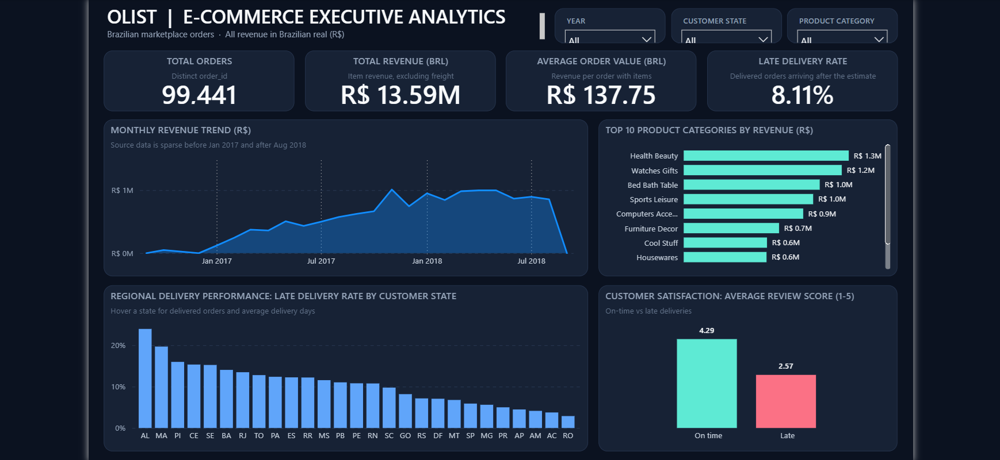
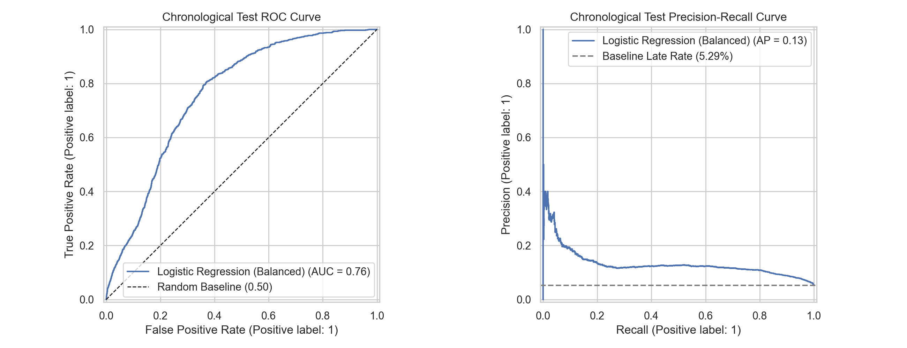
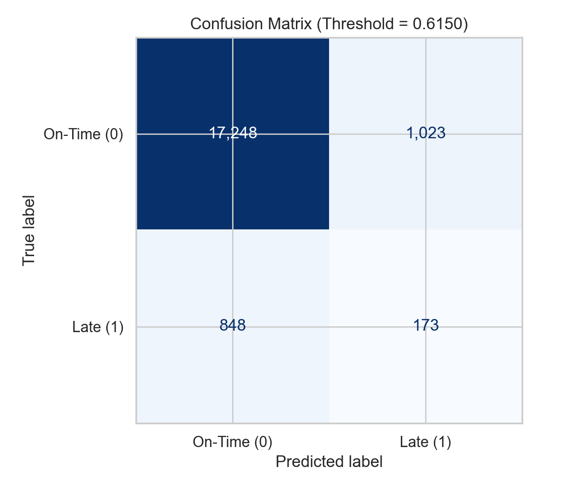
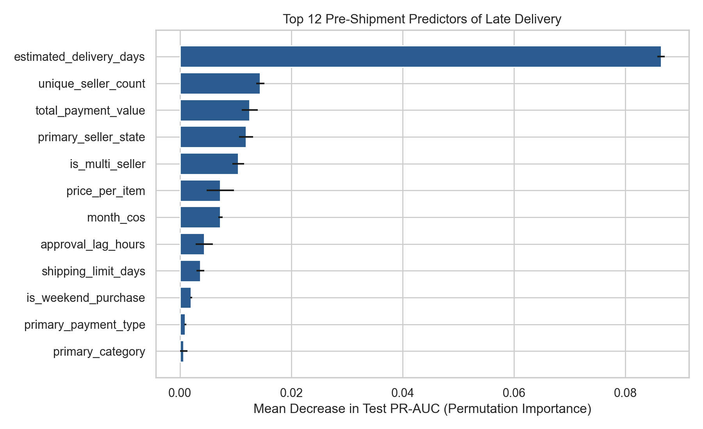
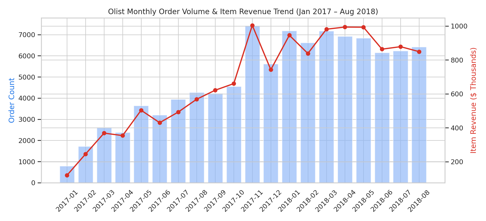
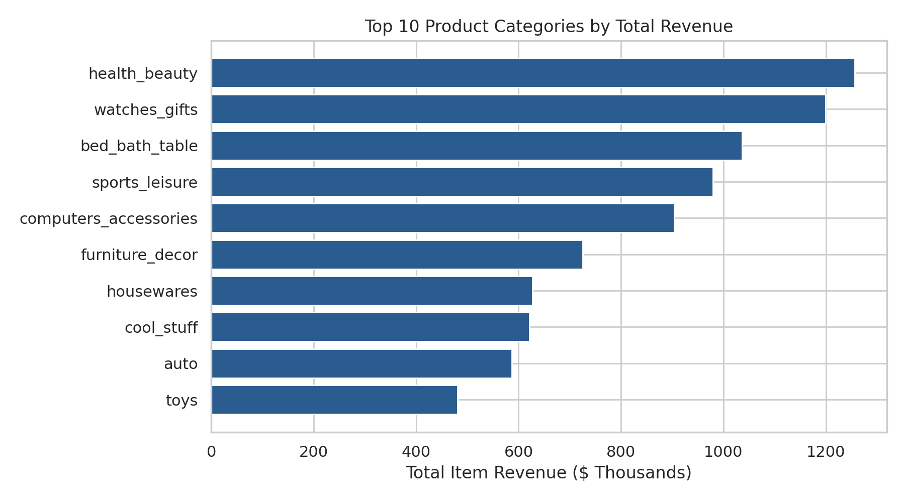
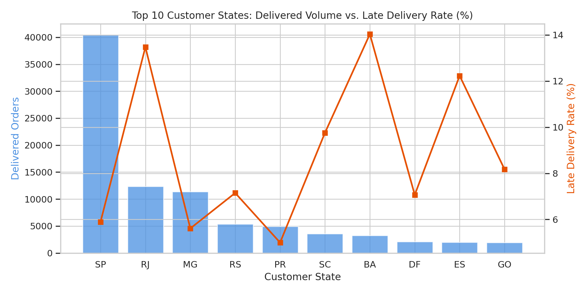
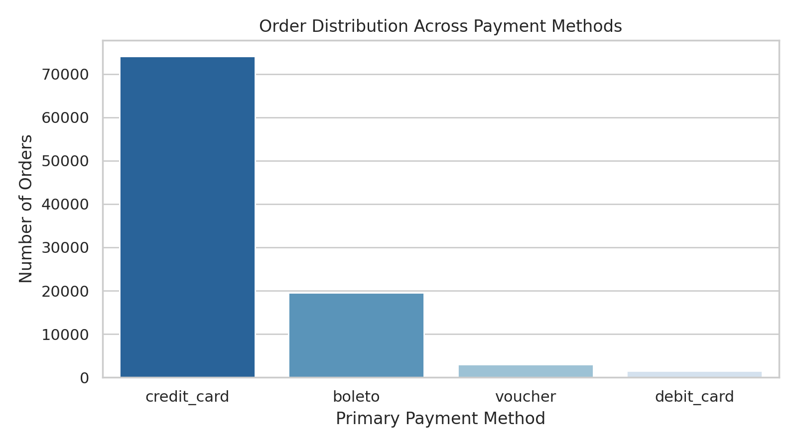
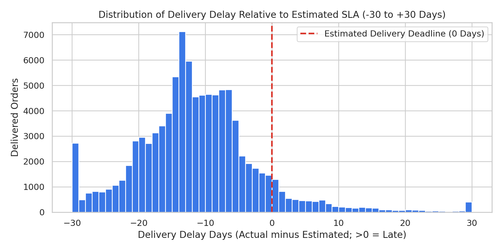
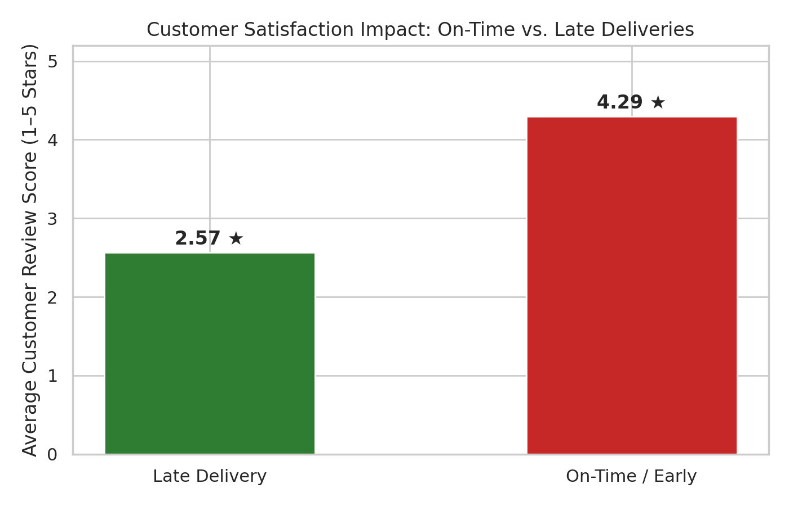

# Olist E-Commerce Analytics & Late Delivery Prediction

**End-to-End Data Analytics and Machine Learning Portfolio Project**

**Technologies:** Python | Pandas | NumPy | Scikit-learn | SQL | Power BI | DAX | Matplotlib | Seaborn | Git

## Project Overview

This project analyzes the Brazilian Olist E-Commerce dataset to understand sales performance, customer behavior, product categories, and delivery efficiency. It also includes a Machine Learning model to predict the risk of late deliveries using historical order information.

The project combines nine relational datasets, Python-based data processing, SQL analysis, exploratory data analysis (EDA), Machine Learning, and an interactive Power BI dashboard.

**Main objectives:**
- Analyze revenue, order trends, product performance, and customer satisfaction.
- Identify delivery delays and regional logistics patterns.
- Build and compare classification models for late-delivery prediction.
- Present business insights through an interactive Power BI dashboard.

## Power BI Dashboard

A one-page interactive dashboard built using Power BI Desktop and DAX.



**Dashboard features:**
- Total Orders, Revenue, Average Order Value (AOV), and Late Delivery Rate
- Monthly Revenue Trend
- Top Product Categories by Revenue
- Regional Delivery Performance
- Customer Satisfaction: On-Time vs. Late Orders
- Interactive Year, Customer State, and Product Category filters

**[Power BI dashboard file](powerbi/dashboard/Olist_Ecommerce_Analytics.pbix)**

### Key Business Metrics

| Metric | Result |
|---|---:|
| Total Orders | 99,441 |
| Orders with Items | 98,666 |
| Total Item Revenue | R$13.59M |
| Gross Merchandise Value (GMV) | R$15.84M |
| Average Order Value | R$137.75 |
| Delivered Orders in Historical Analysis | 96,470 |
| Late Delivery Rate | 8.11% |
| Average Delivery Time | 12.56 days |

*Revenue and GMV are expressed in Brazilian reais (BRL). Metrics are based on the historical Olist dataset.*

## Business Insights

### 1. Sales and Revenue

The dataset contains 99,441 orders from 2016 to 2018, with R$13.59 million in item revenue.

The analysis identifies monthly sales trends, leading product categories, and revenue contributions across the marketplace.

### 2. Delivery Performance

Of the 96,470 delivered orders included in the historical delivery analysis, 7,826 arrived after their estimated delivery dates.

This represents an **8.11% late-delivery rate**.

Delivery performance also varies across Brazilian states, indicating differences in regional logistics outcomes.

### 3. Customer Satisfaction

Late deliveries are associated with lower customer review scores.

| Delivery Status | Average Review Score |
|---|---:|
| On Time | 4.29 / 5 |
| Late | 2.57 / 5 |

Late deliveries received an average review score approximately 1.72 points lower than on-time deliveries.

This is an observed association, not proof that delivery delays alone caused the difference.

### 4. Product Performance

Leading product categories by revenue include:

- Health & Beauty
- Watches & Gifts
- Bed, Bath & Table
- Sports & Leisure
- Computers & Accessories

These findings help identify major revenue contributors and opportunities for category-level analysis.

## Machine Learning: Late Delivery Prediction

### Business Problem

Late deliveries can affect customer satisfaction and marketplace operations.

The objective of the Machine Learning component is to classify whether a delivered order is likely to arrive after its estimated delivery date, using historical features available or expected to be available before shipment.

### Data Preparation

The original nine Olist datasets were integrated into an order-level analytical dataset.

Preprocessing included:

- Handling missing values and standardizing data types.
- Aggregating multiple order items and payments.
- Deduplicating geolocation records.
- Combining customer, seller, product, order, and payment information.
- Creating a binary target variable, `is_late`.

The Machine Learning dataset excludes orders without valid payment approval timestamps and other required modeling information.

**Modeling dataset:** 96,456 eligible delivered orders.

### Feature Engineering

The model uses 30 engineered and selected features covering:

| Feature Group | Examples |
|---|---|
| Order information | Item count, order value, freight value |
| Delivery estimates | Estimated delivery days, shipping limit days |
| Customer and seller geography | Distance, state, interstate delivery |
| Product information | Category, weight, volume |
| Payment information | Payment type, installments, total payment value |
| Time-related features | Purchase hour, weekday, month, approval delay |

Seller-to-customer distance is estimated using the Haversine formula.

Post-delivery information, including actual delivery dates and review scores, is excluded from model inputs.

**Limitation:** This is a historical offline prediction experiment. Availability of all features immediately after payment approval needs further validation before real-time deployment.

### Machine Learning Algorithms

Three classification algorithms were compared:

1. Logistic Regression (Balanced)
2. Random Forest (Regularized)
3. HistGradientBoosting (Regularized)

The workflow uses a chronological train/test split rather than randomly mixing older and newer orders.

Three-fold time-series cross-validation is used for model selection based on Precision-Recall Area Under the Curve (PR-AUC).

The classification threshold is selected using validation data from the training period.

### Model Comparison

| Model | Cross-Validation PR-AUC |
|---|---:|
| **Logistic Regression (Balanced)** | **0.2130** |
| HistGradientBoosting | 0.1987 |
| Random Forest | 0.1916 |

**Selected Model: Logistic Regression (Balanced)**

The final test set was evaluated using the selected model.

### Final Model Performance

| Metric | Result |
|---|---:|
| Test Orders | 19,292 |
| Accuracy | 90.30% |
| Precision | 14.46% |
| Recall | 16.94% |
| F1-Score | 0.1561 |
| ROC-AUC | 0.7604 |
| PR-AUC | 0.1324 |
| Decision Threshold | 0.6150 |

The test set contains approximately 5.29% late orders.

Accuracy is not the most informative measure for this imbalanced classification problem. PR-AUC, precision, recall, and F1-score provide a more meaningful understanding of late-delivery detection.

The selected model has useful ranking ability, but its low recall and precision show that it is not ready to be treated as a reliable operational alert system.

## Machine Learning Visualizations

### ROC and Precision-Recall Curves



The ROC curve evaluates how well the classifier separates late and on-time deliveries across decision thresholds.

The precision-recall curve is particularly useful because late deliveries represent a small proportion of the test dataset.

### Confusion Matrix



The confusion matrix shows the number of correctly classified and misclassified orders.

Final evaluation results:

- True Negatives: 17,248
- False Positives: 1,023
- False Negatives: 848
- True Positives: 173

These results show that detecting late deliveries remains challenging.

### Feature Importance



Permutation feature importance helps examine which inputs contribute most to predictive performance.

The analysis uses the decrease in PR-AUC when individual features are shuffled.

## Exploratory Data Analysis

The project also includes visualizations covering sales, product categories, delivery performance, payment methods, and customer reviews.

**Monthly Revenue and Orders**



**Top Product Categories**



**Regional Delivery Performance**



**Payment Methods**



**Delivery Delay Distribution**



**Delivery Performance and Review Scores**



## SQL Analysis

MySQL queries are included for examining:

- Data quality and missing values
- Revenue and order trends
- Product category performance
- Seller performance
- Customer and regional distribution
- Delivery delays
- Business KPIs

SQL techniques include joins, aggregations, CTEs, window functions, primary and foreign keys, and indexes.

SQL files are available in the [`sql/`](sql/) directory.

## Project Structure

```text
olist-ecommerce-analytics/
│
├── data/
│   ├── raw/
│   ├── processed/
│   └── README.md
│
├── notebooks/
│   ├── 01_data_understanding.ipynb
│   ├── 02_data_cleaning.ipynb
│   ├── 03_exploratory_data_analysis.ipynb
│   ├── 04_feature_engineering.ipynb
│   ├── 05_machine_learning.ipynb
│   └── 06_model_evaluation.ipynb
│
├── src/
│   ├── data/
│   ├── features/
│   ├── models/
│   └── prediction.py
│
├── models/
│   └── saved_models/
│
├── powerbi/
│   ├── dashboard/
│   │   └── Olist_Ecommerce_Analytics.pbix
│   ├── screenshots/
│   │   └── Olist_Executive_Dashboard.png
│   └── README.md
│
├── reports/
│   ├── figures/
│   ├── model_results/
│   └── business_insights.md
│
├── sql/
│   ├── schema.sql
│   ├── data_quality.sql
│   └── business_analysis.sql
│
├── tests/
├── .gitignore
├── requirements.txt
└── README.md
```

## How to Run the Project

### 1. Clone the Repository

```bash
git clone https://github.com/AbhijithEnabothula/olist-ecommerce-analytics.git
cd olist-ecommerce-analytics
```

### 2. Install Dependencies

Python and the required libraries must be installed.

```bash
python -m pip install -r requirements.txt
```

### 3. Download the Olist Dataset

Download the Brazilian E-Commerce Public Dataset by Olist from Kaggle:

https://www.kaggle.com/datasets/olistbr/brazilian-ecommerce

Place the nine CSV files inside `data/raw/`.

Large raw and processed datasets are excluded from GitHub. See [`data/README.md`](data/README.md) for details.

### 4. Run the Analysis

Open the Jupyter notebooks in the `notebooks/` folder to review data understanding, preprocessing, EDA, feature engineering, model training, and evaluation.

The reusable processing, training, and prediction code is available in `src/`.

### 5. Run Automated Tests

```bash
python -m pytest tests -q
```

Latest verified local result:

**6 tests passed.**

### 6. Run the Prediction Script

```bash
python -m src.prediction
```

This script loads the saved pipeline and generates late-delivery predictions for example orders.

The examples are demonstrations, not live marketplace orders. Their scores should not be interpreted as calibrated real-world probabilities.

### 7. View the Power BI Dashboard

Open:

`powerbi/dashboard/Olist_Ecommerce_Analytics.pbix`

Power BI Desktop is required.

The dashboard uses the processed master dataset. If the dataset is unavailable locally, regenerate it from the raw source files and update the Power BI CSV connection.

## Future Improvements

- Improve late-delivery detection through additional feature engineering and model experimentation.
- Validate prediction-time feature availability more rigorously.
- Explore probability calibration and business-specific alert thresholds.
- Add model monitoring and reproducibility checks.
- Develop an API for prediction using a Python backend.
- Evaluate model performance across different time periods and regions.

## Skills Demonstrated

**Data Analytics:** Data cleaning, EDA, descriptive statistics, KPI analysis, business reporting

**Machine Learning:** Classification, feature engineering, chronological validation, cross-validation, imbalanced classification, model evaluation, prediction pipelines

**SQL:** Joins, aggregations, CTEs, window functions, schema design

**Power BI:** Data modeling, DAX measures, KPI cards, interactive slicers, dashboard development

**Python:** Pandas, NumPy, Scikit-learn, Matplotlib, Seaborn, Joblib

**Development Tools:** VS Code, Jupyter Notebook, Git, GitHub

## Dataset Credits

This project uses the **Brazilian E-Commerce Public Dataset by Olist**, available on Kaggle.

The dataset contains anonymized historical Brazilian e-commerce transactions from 2016 to 2018.

## Project Note

This is a portfolio project developed for learning and demonstrating Data Analytics and Data Science workflows.

All reported metrics relate to the historical dataset and the documented experimental setup. The model is not deployed in a production environment.
