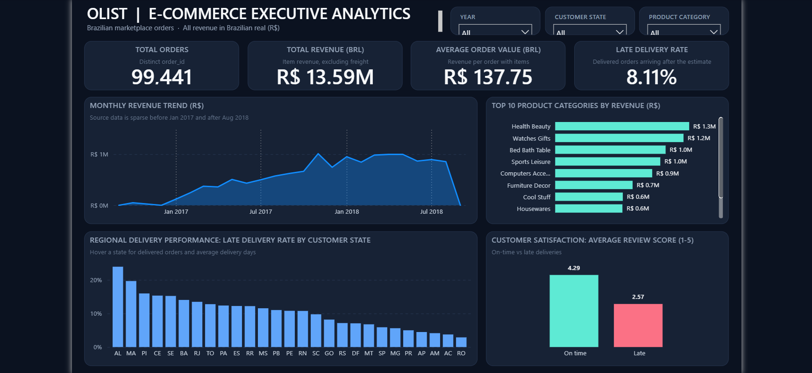

# Power BI Dashboard — Olist E-Commerce Analytics

## Overview

This folder contains a one-page interactive Power BI dashboard created using Power BI Desktop.

The dashboard analyzes sales performance, product categories, delivery efficiency, regional logistics, and customer satisfaction using the historical Olist E-Commerce dataset.

## Dashboard Preview

## Dashboard Features

| Component | Description |
|---|---|
| Total Orders | 99,441 unique orders |
| Total Revenue | R$13.59 million in item revenue |
| Average Order Value | R$137.75 |
| Late Delivery Rate | 8.11% |
| Monthly Revenue Trend | Revenue performance over time |
| Top Product Categories | Highest-revenue product categories |
| Regional Delivery Performance | Late-delivery rate by Brazilian state |
| Customer Satisfaction | Average review scores for on-time and late orders |

The dashboard includes interactive Year, Customer State, and Product Category slicers.

## Open the Dashboard

1. Install Microsoft Power BI Desktop.
2. Open `dashboard/Olist_Ecommerce_Analytics.pbix`.
3. If the data source needs updating, connect it to `data/processed/olist_orders_master.csv` in the main project folder.
4. Refresh the data.

The processed dataset can be regenerated from the original Olist CSV files using the project's Python preprocessing code.

## Files

- `dashboard/Olist_Ecommerce_Analytics.pbix` — Editable Power BI dashboard.
- `dashboard/dashboard_specification.md` — Original dashboard design and DAX reference.
- `screenshots/Olist_Executive_Dashboard.png` — Dashboard screenshot.

## Tools Used

Power BI Desktop, Power Query, DAX, data modeling, interactive slicers, KPI cards, and data visualization.

## Note

The dashboard is based on historical Brazilian e-commerce data from 2016–2018. The values shown are dataset findings, not live business metrics.